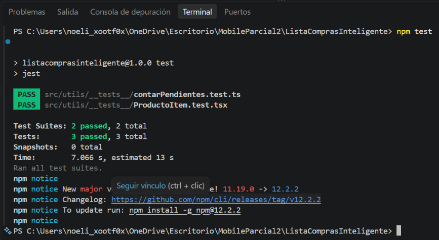

# Lista de compras inteligente — Útiles escolares

Aplicación desarrollada con React Native, Expo y TypeScript para organizar la compra de útiles escolares.

## Autora

Noelia Sanabria

## Tecnologías

- React Native y Expo SDK 57.
- TypeScript.
- React Navigation con Native Stack.
- AsyncStorage.
- Zustand.
- expo-notifications.
- expo-image-picker.
- expo-file-system.
- expo-location.
- expo-contacts.
- expo-calendar.
- Jest, jest-expo y React Native Testing Library.

## Cómo ejecutar

Se necesita Node.js, npm y un celular con Expo Go compatible con SDK 57.

Desde la carpeta del proyecto:

    npm ci
    npm start

Escanear el código QR con Expo Go. Para una conexión local, el celular y la computadora deben estar conectados a la misma red Wi-Fi.

## Cómo usar la aplicación

1. Registrar una cuenta e iniciar sesión.
2. Entrar en «Agregar útil» y escribir el nombre.
3. Tomar una foto o elegirla de la galería.
4. Escribir la dirección del comercio o guardar la ubicación actual si estás en el comercio.
5. Seleccionar un proveedor de los contactos.
6. Guardar el útil y revisar los datos en la lista.
7. Marcarlo como comprado, eliminarlo o crear el evento de compra en el calendario.

La foto, la dirección, la ubicación y el contacto son opcionales. Para guardar un útil solo es obligatorio ingresar su nombre.

El recordatorio local de 5 segundos se utiliza desde Home cuando hay útiles pendientes.

## Tests

Ejecutar:

    npm test

Se incluyen tres pruebas:

1. Renderizado del nombre y los botones de `ProductoItem`.
2. Ejecución de la acción de eliminar al presionar el botón.
3. Cálculo de pendientes excluyendo los útiles comprados.

## Pruebas en el celular

Comprobar:

- Acceso a cámara, galería, GPS, contactos y calendario.
- Comportamiento al aceptar o rechazar permisos.
- Cancelación de la selección de imagen o contacto.
- Conservación de los datos al cerrar y volver a abrir la aplicación.
- Recepción de la notificación local.
- Creación del evento en el calendario

## Parcial 1

### Funcionalidades

- Registro local con usuario y contraseña.
- Inicio de sesión validando los datos guardados.
- Acceso a las pantallas principales únicamente con sesión iniciada.
- Agregar, listar y eliminar útiles escolares.
- Marcar útiles como comprados o pendientes.
- Mostrar la cantidad de útiles pendientes.
- Programar una notificación local a los 5 segundos si hay pendientes.
- Guardar la cuenta y los útiles con AsyncStorage.
- Cerrar sesión.

### Pantallas

- Login.
- Registro.
- Home.
- Alta de producto.

La navegación utiliza React Navigation con Native Stack.
La lista reutiliza el componente `ProductoItem`.

### Autenticación

La autenticación es local, sin backend. Se permite registrar una cuenta por dispositivo y la contraseña se guarda sin cifrado, como permite la consigna.

Al cerrar sesión se conservan la cuenta y los útiles. Al reiniciar la aplicación es necesario volver a iniciar sesión.

## Parcial 2

Se continúa la aplicación del parcial 1 incorporando recursos del dispositivo y estado global.

### Cámara y galería

- Tomar una foto o seleccionar una imagen de la galería.
- Asociar la imagen a un útil escolar.
- Guardar la imagen en el dispositivo y mostrarla en la lista.

### Ubicación

- Escribir manualmente la dirección del comercio donde se quiere comprar.
- Obtener la ubicación actual del dispositivo.
- Asociarla al útil como ubicación del comercio.
- Mostrar sus coordenadas en la lista.

### Contactos

- Seleccionar un contacto de la agenda del celular.
- Asociarlo al útil como proveedor.
- Mostrar su nombre y teléfono, cuando esté disponible.

### Calendario

- Crear un evento de compra vinculado a un útil.
- Programarlo para el día siguiente a las 10, con un aviso 10 minutos antes.
- Guardar la fecha y el identificador del evento en el producto.

El evento utiliza la dirección escrita del comercio. Si no se ingresó una dirección,
utiliza las coordenadas GPS guardadas, cuando estén disponibles.

Se utiliza el primer calendario editable del dispositivo. Si no hay uno disponible, se muestra un mensaje.

Eliminar el útil de la lista no elimina el evento del calendario.

### Permisos

Se solicitan permisos antes de acceder a cámara, galería, ubicación, contactos y calendario.

Mientras se espera la respuesta, los botones se deshabilitan. Si se rechaza el permiso, se muestra un mensaje indicando cómo continuar.

### Estado global

La lista de productos se maneja con Zustand en
`src/context/ProductosContext.tsx`.

El store contiene acciones para cargar, agregar, actualizar, marcar y eliminar productos.

Se mantiene AsyncStorage para conservar los datos y recuperar los útiles guardados en el parcial 1. La autenticación conserva su contexto original.

## Videos de demostración

- Parcial 1: pendiente de agregar enlace de YouTube.
- Parcial 2: [Ver demo del parcial 2 en YouTube](https://www.youtube.com/shorts/xlbjtSpU7p8).

